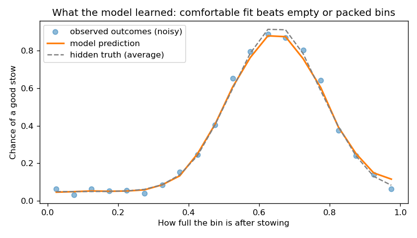

# Stow Recommender: which bin should this item go in?

When a warehouse associate stows a new item, they need to choose a bin on a shelving unit (a *pod*). This project recommends the best bins for an item: an **ML model ranks the bins by how good the fit is**, and a layer of **hard safety rules** marks forbidden bins in red, which the model can never override.

*Inspired by my experience working in warehouse inventory. All data, rules and the pod layout here are simplified and fully synthetic; nothing is taken from any real company's systems.*

## The rules

**What makes a good fit (learned by the model):**
- An item that fills a bin *exactly* is bad: it's hard to pick out later.
- A big, nearly empty bin for a small item is also bad: it wastes space.
- Best is a **comfortable fit**: the bin ends up reasonably full, with some space around the item.

**Hard rules (never broken):**

| Rule | Why |
|---|---|
| The item must physically fit (any rotation) and there must be enough free space | Obvious |
| Heavy items stay low: max 25 kg on levels 1–2, 12 kg on levels 3–4, 4 kg on levels 5–6 | Safety when lifting |
| Two hazardous items (can break or spill) never share a bin | One spill or breakage shouldn't damage another hazardous item |
| Tiny items (longest side under 3 cm) only go in small bins | Easy to find, can't get lost or fall out |

## How it works

```
item + pod (24 bins)
      │
      ▼
 hard rules ──► forbidden bins: RED, with the reason ("too heavy for level 6 (max 4 kg)")
      │
      ▼ allowed bins only
 ML model scores each bin (chance of a good stow)
      │
      ▼
 top 3 = BEST FIT, the rest = GOOD FIT
```

The model only ever sees allowed bins, so it **cannot** recommend a forbidden one. A test checks this on 300 random items and pods.

### The pod

6 levels (1 = floor, 6 = top shelf), 4 bins per level. Large bins (50×40×45 cm) at the bottom, medium (35×30×40) in the middle, small (25×20×35) at the top, with two small bins on level 4.

## Why use ML if we know the rules?

In a real warehouse, nobody can write down exactly what makes a stow "good". It depends on item shapes, how the bin is already arranged, how associates work, and more. What you *do* have is a log of past stows and whether they worked out (e.g. the item was easy to pick later). The model learns the fit preference from those outcomes.

Here, that log is **simulated**. Behind the simulation is a hidden "truth" (comfortable fit, space around the item), plus a hidden random factor for things the data doesn't capture. The model never sees the truth, only noisy good/bad outcomes. Because I know the truth, I can **check** whether the model really learned it. That's a standard way to validate a method before trusting it on real data.

## Results

<!-- Fill in from the output of `python -m stow_recommender.train` (also in reports/metrics.json) -->

Ranking quality on 500 new, unseen scenarios:

| Method | NDCG@3 | Top pick is one of the 3 truly best bins |
|---|---|---|
| **ML model** | _fill in_ | _fill in_ |
| Tightest fit (classic bin packing) | _fill in_ | _fill in_ |
| Most free space | _fill in_ | _fill in_ |
| Random allowed bin | _fill in_ | _fill in_ |

**Key insight:** the classic "pack it as tight as possible" strategy is *no better than random* here, because tightly packed bins are hard to pick from. The model learned the comfortable-fit sweet spot purely from noisy outcomes:



### Example (`python -m stow_recommender.demo --seed 10`)

A heavy, hazardous item:

```
Item DEMO: 24.6 x 38.2 x 23.3 cm, 7.27 kg, hazardous: yes

Pod (top shelf first)    [1][2][3] = best fit   ok = good fit   XX = not allowed

  Level 6 |  XX S  49%  |  XX S  54%* |  XX S  20%  |  XX S  84%
  Level 5 |  XX S  33%  |  XX S  71%  |  XX S  29%* |  XX S  39%
  Level 4 | [3] M  13%  |  XX M  74%  |  XX S  22%* |  XX S  12%
  Level 3 |  ok M  26%  |  ok M  44%  |  ok M  24%  |  ok M  28%
  Level 2 |  ok L  70%  |  ok L  12%  |  ok L  12%  |  ok L  19%
  Level 1 |  ok L  59%  | [1] L  36%  |  ok L  70%  | [2] L  49%

  S/M/L = bin size, % = how full now, * = holds a hazardous item

  Best fit 1: P1-L1-C2  (score 0.89)
  Best fit 2: P1-L1-C4  (score 0.77)
  Best fit 3: P1-L4-C1  (score 0.57)

  Not allowed:
    11 bins: does not fit
     4 bins: too heavy for level 5 (max 4 kg)
     4 bins: too heavy for level 6 (max 4 kg)
     3 bins: bin already holds a hazardous item
```

Bin L4-C1 would end up at a comfortable 65% full, but the item's sides leave less than 2 cm of space in a medium bin, so the model ranks it only third. The level-3 bins would end up 76–96% full, which is too tight.

(Your exact output depends on your trained model.)

## Project structure

```
stow_recommender/
  config.py      Pod layout, bin sizes, weight limits, tiny-item threshold
  domain.py      Item and Bin, and building a pod
  rules.py       Hard rules, with a plain-language reason for every violation
  features.py    Fill before/after, clearance around the item, sizes, weight, level
  simulate.py    Synthetic items, pods and stow history (with the hidden truth)
  evaluate.py    Ranking metrics: NDCG@3 and top-pick accuracy
  train.py       Trains the model, compares it with baselines, saves model and plot
  recommend.py   Rules + model -> best fit / good fit / not allowed
  demo.py        Shows a recommendation in the terminal
```

## How to run

```bash
python -m venv .venv
source .venv/bin/activate          # Windows: .venv\Scripts\activate
pip install -r requirements.txt

python -m stow_recommender.train         # train (~30 seconds), writes reports/
python -m stow_recommender.demo          # random example
python -m stow_recommender.demo --seed 7 # repeatable example
```

## Design decisions

- **Rules outside the model, not inside it.** Safety rules must hold 100% of the time. A model learns probabilities, so it could break a rule occasionally. Keeping rules as a separate filter makes them guaranteed, testable and easy to change.
- **Pointwise ranking.** The model predicts "chance of a good stow" for each bin separately, and bins are sorted by that score. This is the simplest learning-to-rank approach, and it matches the data: each logged stow only tells us about the one bin that was chosen.
- **Evaluated with ranking metrics, not just accuracy.** What matters is whether the *top* recommendations are good, so I use NDCG@3 and whether the top pick is among the truly best 3 bins.
- **Train, holdout and evaluation data come from different random seeds**, so the model is always tested on items and pods it has never seen.

## Limitations

- **All data is synthetic.** The results show that the method works when the truth is known, not how it would perform in a real warehouse.
- **Selection bias:** in the simulation, associates choose randomly among allowed bins. Real associates have habits (e.g. preferring bins at waist height), so real logs would only show some kinds of placements, and the model would need to correct for that.
- **Fit is based on volume and box dimensions only.** Real items have irregular shapes and can't fill a bin perfectly.
- **No picking speed yet:** a real system would also place fast-selling items in easy-to-reach bins.

## Next steps

- Add picking frequency: fast movers go to levels 2–4 (the easiest to reach)
- Try a pairwise ranking model (e.g. LightGBM's LambdaRank) and compare it with the pointwise model
- Extend the hazardous rule to neighbouring bins
- Serve recommendations through a small REST API
